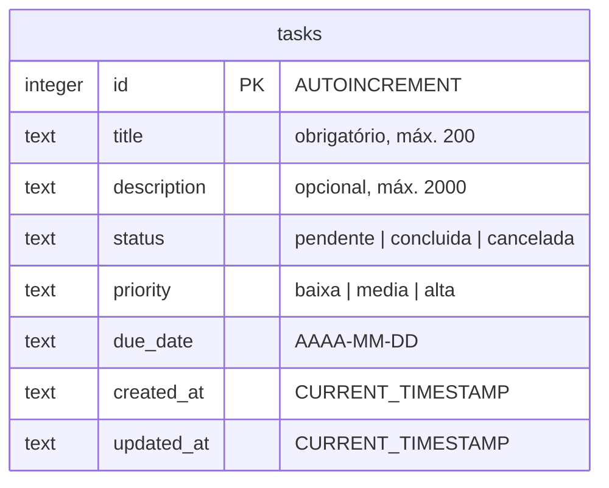
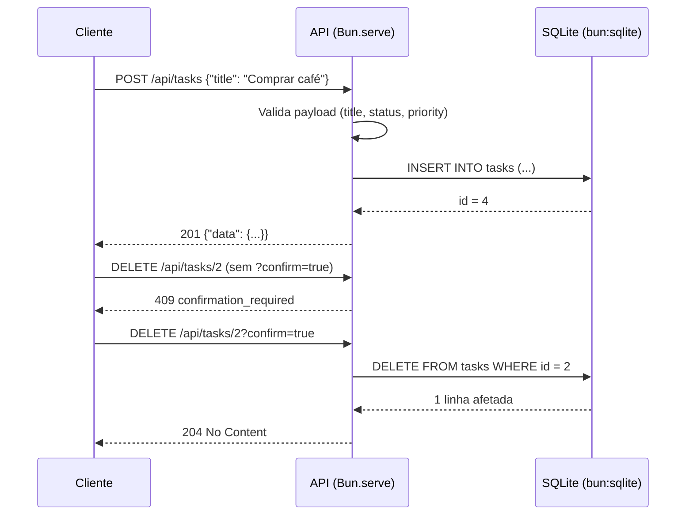

# Minhas Tarefas: API REST com SQLite em VM Azure

API REST de tarefas com operações CRUD completas, validação de dados e banco **SQLite**, construída em **TypeScript** com o runtime **Bun**, sem dependências externas de execução: o banco usa o módulo nativo `bun:sqlite` e o servidor, o nativo `Bun.serve()`.

A API é servida de ponta a ponta por uma **VM Azure** (SKU **B2ats_v2**, região Chile Central, Ubuntu 24.04), gerenciada por um serviço **systemd**, com o banco armazenado fora do código em `/var/lib/minhas-tarefas/`.

> **API em produção**: http://57.156.68.206 · **Relatório completo**: [`docs/Relatorio-Minhas-Tarefas.pdf`](docs/Relatorio-Minhas-Tarefas.pdf) · **Evidências**: [`evidence/`](evidence/)

## Arquitetura

```mermaid
flowchart LR
    C["Cliente HTTP<br/>(navegador / curl)"] -->|"HTTP porta 80"| N["NSG<br/>porta 80 liberada"]
    N --> IP["IP público<br/>da VM"]
    IP --> VM["VM Azure<br/>Ubuntu 24.04 · SKU B2ats_v2<br/>2 vCPU · 1 GiB RAM<br/>Chile Central"]
    subgraph VM[" " 
        direction LR
        S["systemd<br/>minhas-tarefas.service"] --> B["Bun<br/>runtime TypeScript"]
        B --> A["API REST<br/>Bun.serve()"]
        A --> D[("SQLite<br/>bun:sqlite")]
    end
    D --> DISK["/var/lib/minhas-tarefas/tasks.sqlite3<br/>(disco gerenciado 30 GB)"]
```

## Modelo de dados



## Fluxo de uma requisição



## Rotas

| Método | Rota | Descrição |
|---|---|---|
| GET | `/` | Dashboard HTML |
| GET | `/api/health` | Status da API + caminho do banco |
| GET | `/api/tasks` | Lista tarefas (filtro opcional `?status=`) |
| POST | `/api/tasks` | Cria tarefa (validação de campos) |
| GET | `/api/tasks/:id` | Detalha uma tarefa |
| PUT | `/api/tasks/:id` | Atualização parcial (whitelist de campos) |
| DELETE | `/api/tasks/:id` | Exclui: **exige `?confirm=true`** (409 sem ele) |
| GET | `/api/dashboard` | Contadores: total, pendentes, concluídas, canceladas |

Envelopes de resposta: sucesso `{"data": ...}` e erro `{"error": {"code": ..., "message": ...}}`, mesmo padrão HTTP 400 (validação), 404, 409 e 500.

## Executar localmente

```sh
bun install        # apenas tipos de dev; sem deps de runtime
bun test           # 19 testes (HTTP real + unidade)
bun start          # http://localhost:3001
```

O banco é criado automaticamente no primeiro início (fora do código, em `~/.local/share/minhas-tarefas/`), com três tarefas de demonstração. Configure `TODO_API_DB_PATH`, `PORT` e `HOST` por variáveis de ambiente.

### Exemplos

```sh
curl http://localhost:3001/api/health
curl http://localhost:3001/api/tasks?status=pendente
curl -X POST http://localhost:3001/api/tasks \
  -H "Content-Type: application/json" \
  -d '{"title":"Comprar café","priority":"alta","due_date":"2026-11-05"}'
curl -X PUT http://localhost:3001/api/tasks/1 \
  -H "Content-Type: application/json" \
  -d '{"status":"concluida"}'
curl -X DELETE "http://localhost:3001/api/tasks/1?confirm=true"
```

## Estrutura

```
├── src/                            # API REST (TypeScript + Bun)
│   ├── app.ts                      # rotas, handlers e tratamento de erros
│   ├── db.ts                       # conexão SQLite, schema e seeds
│   ├── validate.ts                 # validação e whitelist de campos
│   └── index.ts                    # entrada: config via env + Bun.serve
├── public/
│   └── dashboard.html               # interface web servida em /
├── tests/
│   └── api.test.ts                 # 19 testes (HTTP real + unidade)
├── deploy/
│   ├── provision.sh                 # deploy completo da VM via SSH (1 comando)
│   ├── minhas-tarefas.service      # serviço systemd (porta 80, restart)
│   └── setup-vm.sh                 # instalação de dependências na VM
├── evidence/                       # 12 prints: portal Azure e API em produção
├── docs/
│   ├── Relatorio-Minhas-Tarefas.pdf  # relatório completo (~20 páginas)
│   └── relatorio.html               # fonte do relatório
├── package.json · tsconfig.json · LICENSE
```

## Testes

```sh
bun test
```

Cobrem: seeds do primeiro início, CRUD completo via HTTP real, validação (400), exclusão protegida (409), 404 de rota/recurso e o dashboard. O banco de teste é criado em diretório temporário e descartado ao final.

## Hospedagem (elementos de nuvem)

| Elemento | Especificação |
|---|---|
| Computação | VM Azure, SKU **B2ats_v2** (2 vCPU, 1 GiB RAM), Ubuntu 24.04 LTS (~US$ 9,64/mês) |
| Armazenamento | Disco gerenciado Standard SSD 30 GB; o SQLite vive em `/var/lib/minhas-tarefas/` |
| Rede | VNet, NSG com portas 80 e 22 liberadas, IP público |
| Região | Chile Central: região permitida pela política da assinatura Azure for Students e a mais próxima do Brasil |
| Processo | systemd (`minhas-tarefas.service`) com reinício automático |
| Linguagem | TypeScript 5 + Bun (runtime), sem dependências de execução |

## Provisionamento da VM

Com a VM criada no portal (Ubuntu 24.04, portas 80 e 22 liberadas), o deploy completo é um único comando a partir da máquina local:

```sh
./deploy/provision.sh <IP-da-VM> <caminho-do-pem>
```

O script instala o Bun na VM, copia o código para `/opt/minhas-tarefas`, prepara o diretório do banco em `/var/lib/minhas-tarefas/`, instala e habilita o serviço `minhas-tarefas.service` (porta 80, reinício automático) e valida a API dentro da VM e de fora.

## Créditos

Trabalho acadêmico de Computação em Nuvem, inspirado no material didático [minha-frota](https://github.com/edupopov/minha-frota) (Python + SQLite), aqui reescrito em TypeScript + Bun e estendido com hospedagem de ponta a ponta em nuvem.
